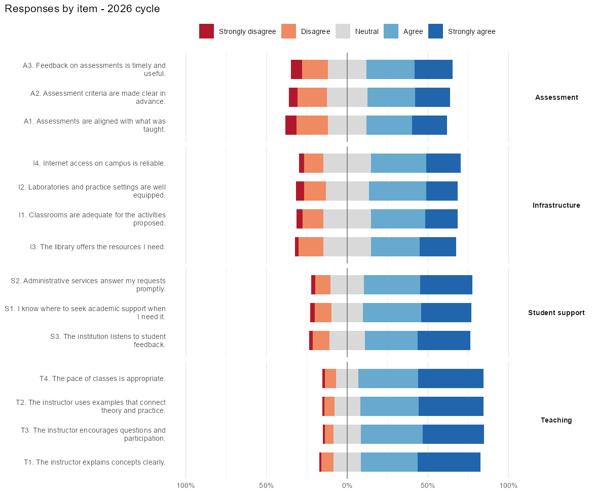
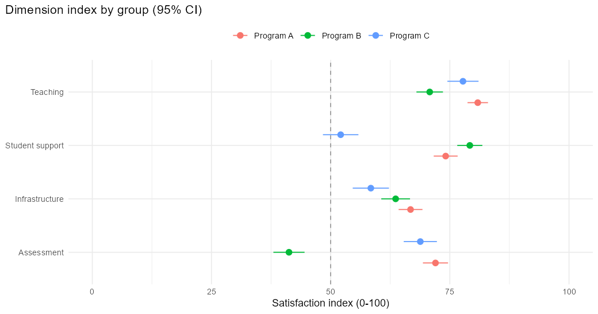

# Likert Survey Analysis


> Reproducible analysis of institutional and course-evaluation surveys —
> from raw Likert answers to an anonymity-safe HTML report.

Institutional self-evaluation surveys produce thousands of answers every
cycle. This project scores them consistently, checks that each dimension is
reliable, compares programs and cycles, and **never shows results for groups
small enough to identify respondents**.

<p align="center">
  
</p>

## ✨ Features

- **Item summaries:** n, mean, % agreement (top-2 box), % disagreement and a 0–100 satisfaction index.
- **Dimension scores** per respondent (minimum answered items configurable) with 95% CIs by group.
- **Reliability:** Cronbach's α and corrected item–total correlations per dimension, flagging the weakest item.
- **Diverging stacked bar charts**, the recommended way to display Likert data.
- **Anonymity protection:** automatic suppression of groups with fewer than *n* respondents (default 10).
- **Cycle comparison:** change in each dimension between evaluation cycles.
- **One-command HTML report** (R Markdown, self-contained).

<p align="center">
  
</p>

*In the example, "Program D" has only 4 respondents and is suppressed from every
group-level table and chart.*

## 🚀 Quick start

```r
# install.packages(c("dplyr", "tidyr", "ggplot2", "rmarkdown", "knitr", "testthat"))
```

```bash
git clone https://github.com/alencarpeixotofilho-cloud/likert-survey-analysis.git
cd likert-survey-analysis
Rscript examples/generate_sample_data.R   # 880 synthetic respondents, 2 cycles
Rscript R/report.R                        # -> docs/report.html + figures
Rscript -e 'testthat::test_dir("tests/testthat")'
```

### Input format

| File | Content |
|---|---|
| `questionnaires/questionnaire.csv` | `item`, `dimension`, `text` |
| `responses.csv` | `respondent`, `cycle`, `program`, `term`, then one column per item (1–5, blank = no answer) |

## 🧮 Methods

| Indicator | Definition |
|---|---|
| % agreement | share of answers 4 or 5 |
| Satisfaction index | `100 × (mean − 1) / 4`, i.e. the mean rescaled from 1–5 to 0–100 |
| Dimension score | mean of a respondent's answered items in the dimension (≥ 2 items) |
| 95% CI | `index ± 1.96 × SD / √n` across respondents |
| Cronbach's α | `k/(k−1) × (1 − Σσ²ᵢ / σ²ₜ)` on complete cases |

## 🗂️ Repository structure

```text
likert-survey-analysis/
├── R/
│   ├── scores.R        # long format, item and dimension scores
│   ├── reliability.R   # alpha and item-total correlations
│   ├── suppression.R   # small-group suppression
│   ├── plots.R         # diverging bars, dimension CIs
│   └── report.R        # renders everything
├── report/report.Rmd   # report template
├── questionnaires/     # fictitious questionnaire
├── examples/           # synthetic data generator
├── docs/               # rendered report and figures
└── tests/testthat/
```

## 🔒 Data & privacy

This repository contains **no real survey data**. Respondents are simulated in
[`examples/generate_sample_data.R`](examples/generate_sample_data.R) from a latent
satisfaction model; programs are named "Program A–D" and ids are fictitious.
The suppression rule is on by default because it is the right default for real data.

## 🛣️ Roadmap

- [x] Item and dimension scoring
- [x] Reliability table
- [x] Diverging Likert charts
- [x] Small-group suppression
- [x] HTML report
- [ ] Open-ended comments: topic modelling and sentiment
- [ ] Confirmatory factor analysis of the dimension structure

## 📚 References

* Heiberger, R. M., & Robbins, N. B. (2014). Design of diverging stacked bar charts for Likert scales and other applications. *Journal of Statistical Software, 57*(5), 1–32.
* Cronbach, L. J. (1951). Coefficient alpha and the internal structure of tests. *Psychometrika, 16*(3), 297–334.

## 📄 License

Released under the MIT License. See [`LICENSE`](LICENSE).
